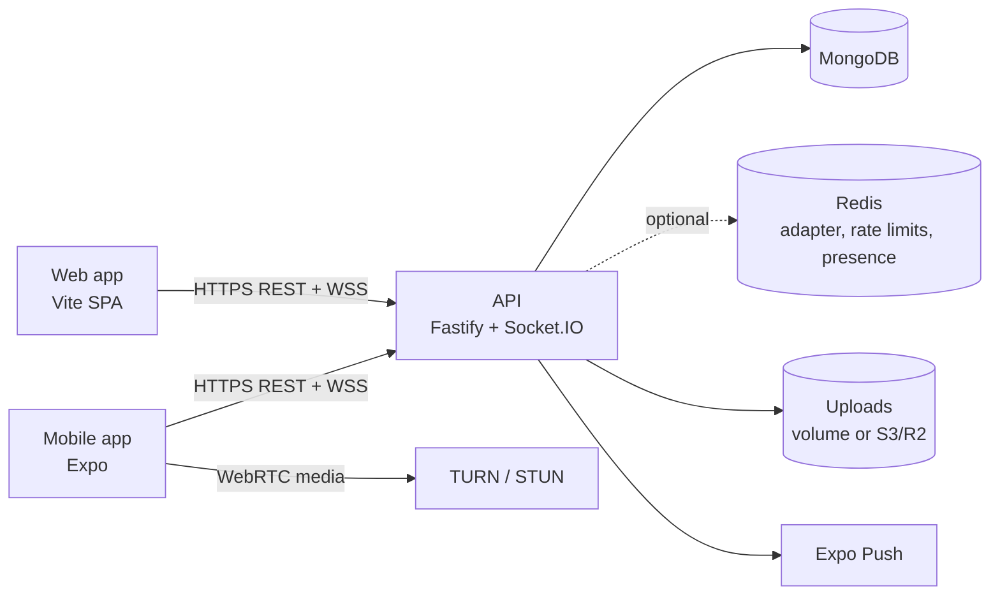

# Architecture

## Shared contract

`packages/shared` is the single source of truth for every request body (zod schemas), every response
shape (TypeScript DTOs) and every Socket.IO event (`ServerToClientEvents` / `ClientToServerEvents`).
The API validates with these schemas, and the web and mobile apps import the same types, so a breaking
change to the contract fails type-checking in every consumer.

## API (`apps/api`)

Feature modules under `src/modules/*` each own a `*.routes.ts` (HTTP surface) and `*.service.ts`
(business logic). Services never touch Socket.IO directly — they emit through `realtime/hub.ts`, which
targets per-user rooms (`user:<id>`) so events work unchanged across several API instances once
`REDIS_URL` enables the Redis adapter.

| Concern               | Implementation                                                                                                                                                            |
| --------------------- | ------------------------------------------------------------------------------------------------------------------------------------------------------------------------- |
| Auth                  | Argon2id passwords; 15-minute JWT access tokens; 30-day opaque refresh tokens stored hashed, rotated on every use, with replay detection that revokes the session         |
| Web sessions          | Refresh token in an `httpOnly`, `SameSite=Lax` cookie scoped to `/v1/auth` (`X-Auth-Mode: cookie`); access token kept in memory                                           |
| Mobile sessions       | Tokens in the Keychain / Android Keystore via `expo-secure-store`, one slot per linked account                                                                            |
| Social sign-in        | Google / Apple ID tokens verified against their JWKS, Facebook tokens via `debug_token`; accounts link on a verified email                                                |
| Messages at rest      | Text encrypted with AES-256-GCM (`MESSAGE_ENCRYPTION_KEY`); admins only ever see metadata                                                                                 |
| Uploads               | Streamed, size-capped, content-sniffed (the declared MIME type is not trusted); served with `nosniff` + sandbox CSP; attachments must reference media the sender uploaded |
| Abuse                 | Global + per-route rate limits (Redis-backed when available), per-socket token buckets, payload validation on every event                                                 |
| Privacy               | Last seen / profile photo / about visibility, read receipts, phone/email discoverability, blocking — enforced server-side when serialising users                          |
| Delivery state        | Each member has `lastDeliveredAt` / `lastReadAt` pointers; ticks are derived from those rather than per-message receipts                                                  |
| Disappearing messages | `expiresAt` + a MongoDB TTL index                                                                                                                                         |
| Calls                 | Socket signalling (`call:invite / signal / accept / decline / end`), call log in MongoDB, missed-call timeout, short-lived TURN REST credentials                          |
| Push                  | Expo push to members with no live socket, honouring per-chat mute                                                                                                         |

## Mobile (`apps/mobile`)

The app is offline-first: Redux holds UI state, SQLite (`expo-sqlite`) caches chats and the latest 200
messages per chat for instant cold starts, and `src/lib/sync` reconciles both with the server.

- `src/lib/api` — typed client (single-flight token refresh), services and server→local mappers
- `src/lib/realtime/socketClient.ts` — one authenticated socket, re-reads the access token on reconnect
- `src/hooks/useRealtimeConnection.ts` — maps socket events into Redux, flushes the outbox on reconnect
- `src/hooks/useChatRealtime.ts` — per-chat paging, optimistic sends (reconciled by `clientId`), uploads with progress
- `src/lib/calling/callEngineManager.ts` — full-mesh WebRTC (one peer per participant) used for 1:1 and group calls
- `src/components/ui` — the Figma design system (Inter type scale, tokens, spring-pressables, sheets)

## Web (`apps/web`)

A Vite SPA with feature folders (`features/auth`, `features/chat`, `features/admin`, `features/profile`).
Server state lives in TanStack Query; socket events patch the query cache directly (`lib/query.ts`), and
ephemeral presence/typing state lives in a small external store (`lib/live-store.ts`). The admin area is
code-split and only reachable by users with the `admin` role.

## End-to-end encryption

Messages are protected in transit (TLS) and at rest (server-side AES-256-GCM), but they are **not**
end-to-end encrypted: the server can decrypt them. The earlier client contained a simulated Signal
implementation that encrypted to a fake peer derived on-device; it gave no real protection and would
have prevented real devices from reading each other's messages, so it was removed. Proper E2EE needs
prekey-bundle distribution, persisted ratchet state, multi-device support and a web implementation —
it's a dedicated project, and the shared contract leaves room for it.
